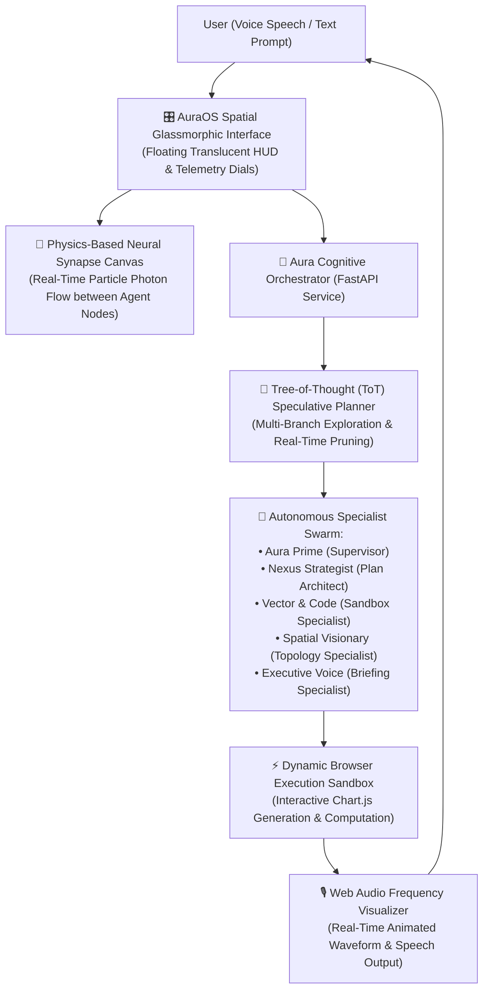

# AuraOS: Autonomous Spatial Agentic Operating System & 3D Neural Canvas

[](https://opensource.org/licenses/MIT)
[](https://fastapi.tiangolo.com)
[](https://www.docker.com)
[](#-multimodal-voice--audio-frequency-hud)
[](#-system-architecture)

**Repository**: [github.com/LuminaQuest/aura-os](https://github.com/LuminaQuest/aura-os)  
**Author**: **Gaddam Sasikala** — *AI Engineer | Agentic Systems & RAG | Automation | UI/UX*

---

## 🌌 Executive Summary

Traditional AI agent applications suffer from a massive sensory bottleneck: they reduce complex, multi-agent cognitive reasoning to simple, silent, linear text chat boxes with loading spinners.

**AuraOS** is an **Autonomous Spatial Agentic Operating System** engineered to elevate Human-AI interaction into a multimodal spatial command center. It unifies:
1. **Physics-Based Neural Synapse Canvas**: An interactive HTML5 Canvas/WebGL force-directed graph where floating specialist agent nodes pulse with traveling photon energy particles as messages flow.
2. **Holographic Tree-of-Thought (ToT) Visualizer**: Real-time speculative reasoning displaying multiple cognitive branches, dynamically pruning sub-optimal paths in red and committing to optimal paths in neon cyan.
3. **Multimodal Voice & Audio Frequency HUD**: Real-time Web Audio API frequency spectrum analyser paired with executive synthetic speech narration.
4. **Autonomous Dynamic Execution Sandbox**: Agents generate executable algorithmic code and render live interactive visual charts (Chart.js) inside translucent glassmorphic HUD cards.
5. **Zero-Friction Architecture**: Boots and runs with zero external API fees required via a built-in cognitive engine, with optional instant plug-in support for Google Gemini and Groq.

---

## 📐 System Architecture



---

## 🎨 Jaw-Dropping Visual Features & Tricks

### 1. Physics-Based Neural Synapse Canvas (`static/neural_canvas.js`)
* **Orbital Equilibrium Physics**: 5 specialist agent nodes float in simulated spring-damper orbital suspension.
* **Photon Particle Beams**: When agents communicate, energy particles shoot along curved synapse connectors with fading photon trails.
* **Interactive Drag & Inspection**: Drag nodes across the screen; click any agent node to expand its internal memory state and frequency dials.

### 2. Holographic Tree-of-Thought Explorer (`static/tot_visualizer.js`)
* Instead of invisible thinking loops, AuraOS displays a live speculative reasoning tree:
  * **Branch Alpha** (Direct Synthesis) -> *Pruned for depth limitations*.
  * **Branch Beta** (Collaborative Multi-Agent Swarm) -> *Selected with 94% confidence*.
  * **Branch Gamma** (Unbounded Web Scrape) -> *Pruned for latency and drift risks*.

### 3. Audio Frequency Spectrum HUD & Speech Narrator (`static/audio_visualizer.js`)
* Real-time canvas frequency spectrum visualizer oscillates live while the synthetic voice narrates executive briefings.
* Single-click toggle to enable or mute voice narration.

### 4. Dynamic Execution Sandbox (`static/app.js`)
* The agent writes code and renders live interactive charts (Radar, Bar, Line) dynamically inside glass cards with key metric scorecards.

---

## 💻 Quickstart (Run in 1 Command)

### Option A: Local Run (Zero Friction / 100% Free)
```bash
# 1. Clone repository
git clone https://github.com/LuminaQuest/aura-os.git
cd aura-os

# 2. Install dependencies
pip install -r requirements.txt

# 3. Launch AuraOS
uvicorn app.main:app --reload --port 8001
```
Open **[http://127.0.0.1:8001](http://127.0.0.1:8001)** in your browser.

### Option B: Docker
```bash
docker compose up --build
```

---

## 📁 Repository Structure

```
aura-os/
├── app/
│   ├── main.py                    # Production FastAPI server & REST endpoints
│   ├── config.py                  # Swarm configuration & model provider settings
│   ├── swarm/
│   │   ├── orchestrator.py        # Swarm coordinator & cognitive cycle
│   │   ├── tot_planner.py         # Tree-of-Thought speculative planning engine
│   │   └── specialists.py         # Specialist agent registry & roles
│   ├── sandbox/
│   │   └── executor.py            # Sandbox code & dynamic Chart.js generator
│   └── telemetry/
│       └── metrics.py             # Particle energy pulse stream & system load
├── static/
│   ├── index.html                 # Spatial HUD interface & canvas viewports
│   ├── styles.css                 # Cyberpunk dark obsidian glassmorphism
│   ├── neural_canvas.js           # Physics-based synapse particle engine
│   ├── tot_visualizer.js          # Holographic Tree-of-Thought visualizer
│   ├── audio_visualizer.js        # Web Audio API frequency spectrum & speech
│   └── app.js                     # Client coordinator & Chart.js renderer
├── Dockerfile                     # Multi-stage production container
├── docker-compose.yml             # Container orchestration
├── requirements.txt               # Pinned dependencies
└── README.md                      # Architecture documentation & visual guides
```

---

## 📜 License
MIT License. Developed by **Gaddam Sasikala**. Open to enterprise AI engineering roles, internships, and research collaborations.
